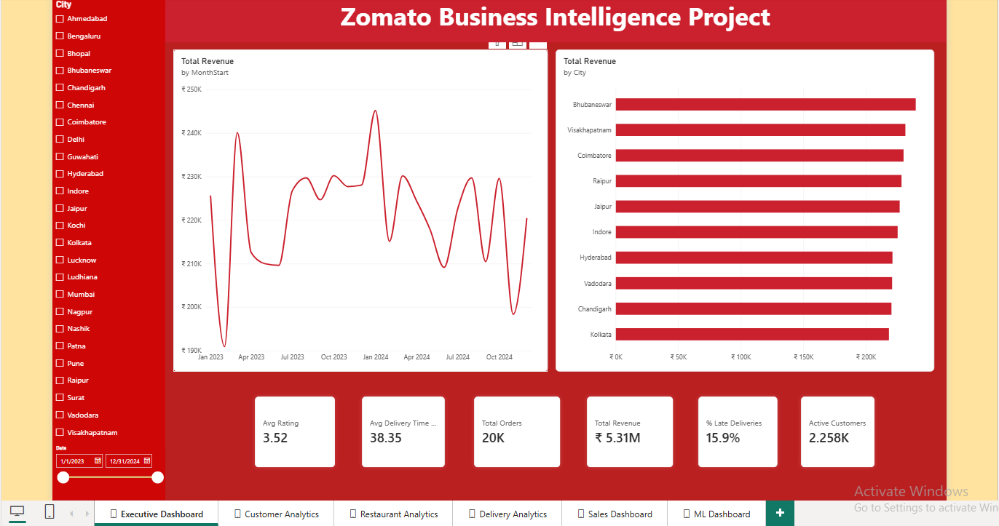
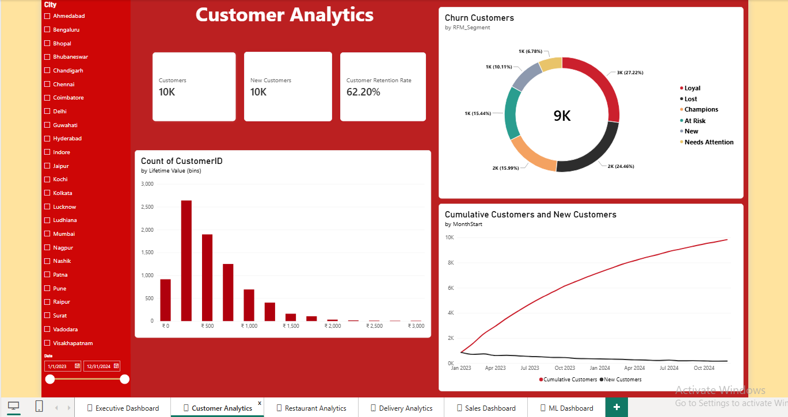
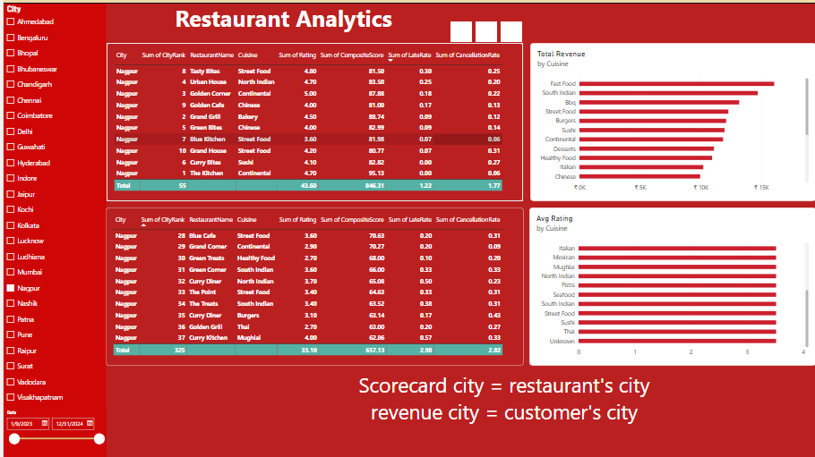
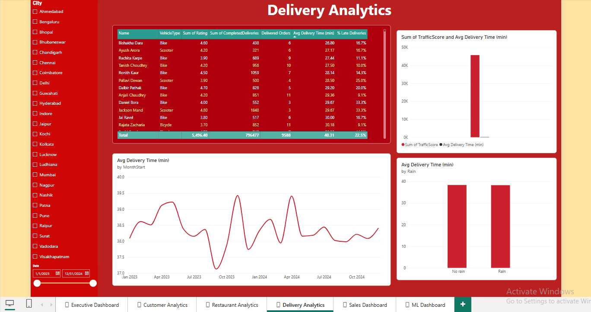
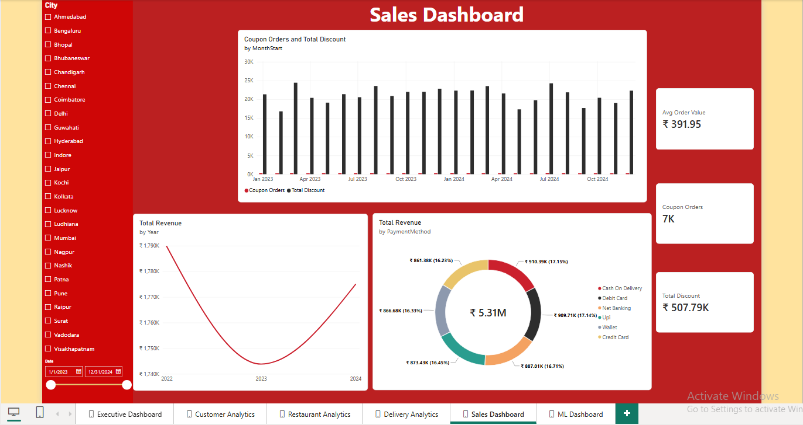
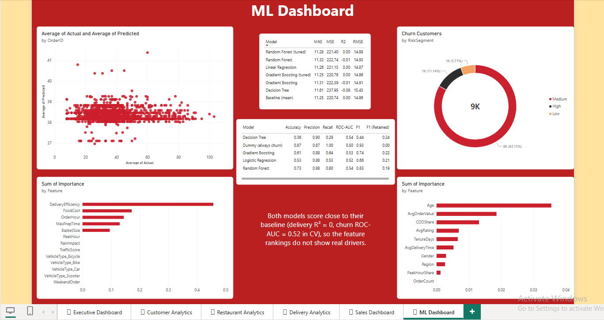

# Zomato Business Intelligence & Delivery Analytics

Internship project (Internmo) built on 12 linked food-delivery datasets: orders, customers, restaurants, delivery partners, payments, promotions, feedback, menu, order items, cities, weather and traffic. The goal was to take messy operational exports and turn them into something the operations, partnerships and marketing teams could actually use: a clean database, SQL reporting, two predictive models and a Power BI dashboard.

Tools: Python (pandas, scikit-learn), PostgreSQL, Power BI Desktop, Matplotlib/Seaborn.

## What's in here

```text
Zomato_BI_Project/
├── data/
│   ├── raw/            # 12 original CSV exports
│   ├── cleaned/        # cleaned tables (CSV + parquet)
│   └── processed/      # features, model outputs, restaurant scores
├── notebooks/          # 00–06: understanding the data → cleaning → EDA → features → models
├── src/                # the same steps as scripts, run end to end by pipeline.py
├── sql/
│   ├── schema.sql              # 3NF schema with primary/foreign keys
│   └── business_queries.sql    # 32 business queries, incl. views, a procedure and a trigger
├── models/             # saved delivery-time and churn models (.pkl)
├── powerbi/            # zomato_dashboard.pbix (6 pages) + theme
├── reports/            # Zomato_Business_Insights_Report.docx
├── documentation/      # data_quality_issues.md (cleaning audit)
└── images/             # ER diagram + screenshots of the 6 dashboard pages
```

## Running it

```bash
pip install -r requirements.txt
python src/pipeline.py
```

This loads the raw files, cleans them, builds features, trains both models and writes the table the dashboard needs (`data/processed/restaurant_scores.csv`). To use the database side, run `sql/schema.sql` in PostgreSQL 14+, load the cleaned CSVs, then run the queries in `business_queries.sql`.

## Database design


The schema is normalised to 3NF around the `orders` table. Each order links to a customer, a restaurant and a delivery partner, and has its own line items, payment and feedback. Customers, restaurants, partners, weather and traffic all join back to `cities`, and orders join to `promotions` through the coupon code. I drew the diagram in dbdiagram.io. The same keys are enforced in `sql/schema.sql`.

## Data cleaning

The raw data had duplicate orders, orders pointing to customers that didn't exist, negative ages, broken phone numbers and city names spelled several different ways. All 9 known issues from the PRD were fixed, and only 562 of 159,077 rows (0.35%) were dropped, each for a documented reason. The full audit, table by table, is in `documentation/data_quality_issues.md`.

## Main findings

- About a third of orders fail: 22.3% are cancelled and 11.5% end as "Food Not Delivered". That's ₹27.1 lakh lost, compared with ₹53.1 lakh delivered over 2023–24.
- The bottom-10 restaurants in each city cancel 28.5% of orders, against 16% for the top 10. The composite score (40% rating, 30% cancellations, 30% late deliveries) ranks all 1,200 restaurants within their own city.
- Delivery time hardly changes with weather, traffic or peak hours (each makes less than a minute of difference). Ludhiana and Nagpur have the most late deliveries, at around 18%.
- 38% of customers only ever ordered once. Of the 9,488 customers who had ordered by 1 Nov 2024, 87% placed no order in the final 60 days.
- Orders peak at 12–1 pm and 7–8 pm. Weekdays and weekends look about the same.

The full write-up with recommendations is in `reports/Zomato_Business_Insights_Report.docx`.

## Models

| Model | Best result | Baseline | PRD target |
| --- | --- | --- | --- |
| Delivery time (regression, 6 models tried) | RMSE 14.9 min, R² ≈ 0 | RMSE 14.9 min | R² ≥ 0.75, RMSE ≤ 6 |
| Churn in 60 days (classification, 4 models tried) | F1 0.83, ROC-AUC 0.54 | F1 0.93 (predict everyone churns) | F1 ≥ 0.70 |

Neither model beats its simple baseline. The delivery model misses both targets. The churn F1 of 0.83 clears 0.70 only because 87% of customers churn, and a model that predicts "churn" for everyone scores higher. The data doesn't include the things that probably drive these outcomes: promised delivery time, kitchen wait time, partner location at assignment and cancellation reasons. The feature importances are still useful. Partner delivery efficiency, food cost, order hour and prep time matter most for delivery time, while weather and traffic get zero importance.

## Dashboard

`powerbi/zomato_dashboard.pbix` has six pages built from the cleaned and processed CSVs, following PRD Section 25. Every page except the ML one has a city filter and a date slider down the left side. If the project folder moves, update the `DataFolder` parameter in Power Query and refresh.

**Executive Dashboard:** the headline numbers for 2023–24 (₹5.31M revenue, about 20K orders, 3.52 average rating, 38.35 min average delivery time, 15.9% late deliveries), monthly revenue and revenue by city.



**Customer Analytics:** customer count and retention rate (62.2%), customers split by RFM segment, the spread of customer lifetime value, and cumulative vs new customers by month. New sign-ups slow down steadily after early 2023.



**Restaurant Analytics:** the top and bottom 10 restaurants in the selected city by composite score, plus revenue and average rating by cuisine. The scorecard uses the restaurant's city and the revenue charts use the customer's city, so the note on the page spells that out.



**Delivery Analytics:** a partner table (vehicle, rating, completed deliveries, average time, % late), average delivery time by month, and delivery time in rain vs no rain. The monthly line stays between 37 and 39.5 minutes, and rain makes almost no difference.



**Sales Dashboard:** average order value (₹391.95), coupon orders and total discount by month, yearly revenue, and revenue by payment method. Each payment method brings in about 16–17%.



**ML Dashboard:** comparison tables for both models, predicted vs actual delivery time, customers by churn risk segment, and feature importance for both models. The note in the middle says both models score close to their baselines.



## Known limitations

- "Late" comes from the order status, because the data has no promised delivery time.
- Weather and traffic are daily city-level averages, not the conditions at the moment each order was placed.
- A few restaurant ratings were filled in with the city median before scoring.
